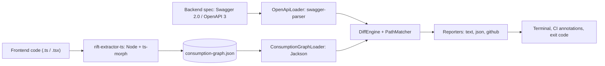

# Architecture

## Why two languages

Reading TypeScript properly needs the TypeScript compiler. `ts-morph` wraps it and exposes the syntax tree and the type checker, which is how rift follows an identifier to its declaration, including across files. Nothing comparable exists for Java.

The comparison itself has no reason to know anything about TypeScript. So the TypeScript part (the **extractor**) does one job: read frontend code and write `consumption-graph.json`. The Java part (the **core**) reads that file and the spec and does everything else.

The only thing they share is the file format, described in [docs/consumption-graph.md](docs/consumption-graph.md). An extractor for another language (Kotlin, Swift, Dart) only has to write the same JSON, and the core does not change.

## The extractor

For every `fetch(...)` call it works out two things, the method and the URL, and for each one it either knows the answer or says it does not.

A URL is rebuilt as a list of **parts**: fixed text, and parameters it could not resolve. A string literal is one text part. A template literal or a `+` joins the parts of each side. A local `const` is replaced by its initializer, and a call to a method with a single `return` by the returned expression. Whatever cannot be followed becomes a parameter part, and that becomes `{name}` in the final path.

Two rules decide how much to trust the result:

- **A URL must start with fixed text.** One that starts with an unknown part could be any path at all, so it is `dynamic` and the core ignores it.
- **Confidence** goes down as knowledge goes down: 1.0 for a plain string, 0.9 for a URL rebuilt from known text, 0.8 when the unknown parts are plain names, 0.5 when one is an expression.

A `let` is followed only if it never changes the path; one that is reassigned has several possible values, and rift refuses to pick.

## The core

1. `OpenApiLoader` reads the spec with `swagger-parser` (Swagger 2.0 and OpenAPI 3 become the same model) and lists `METHOD /full/path`, adding the base path.
2. `ConsumptionGraphLoader` reads the extractor's file and rejects versions it does not know.
3. `DiffEngine` takes each resolved call, keeps the endpoints with the same method, and asks `PathMatcher` for the best match. No match gives `MISSING_ENDPOINT`. Every endpoint that no call reached gives `ORPHAN_ENDPOINT`.
4. A reporter prints the result and the CLI picks the exit code.

`PathMatcher` compares paths segment by segment and returns a **strict** or **loose** match. Strict beats loose, and more identical fixed segments beat fewer. That keeps a call to `/boards/{id}` from being credited to `/boards/search`.

Confidence travels with every finding. A missing endpoint carries the confidence of the call that produced it. An orphan carries the share of frontend calls that were understood, because the less of the frontend was read, the likelier an unused endpoint is used by a call that was not.

## Decisions worth knowing

- **Precision over coverage.** A false alarm costs more trust than a missed finding, so uncertain calls are skipped and counted in the coverage line instead of reported.
- **Silence by default.** Findings below `--min-confidence` are hidden, and the report always says how many.
- **Only endpoints that break the frontend fail the build.** A missing endpoint fails it. An orphan is a cleanup candidate, so it does not, unless you ask with `--fail-on all`.
- **Exit codes are part of the interface.** `1` means findings, `2` means rift could not run, so a broken setup never looks like a clean pass.